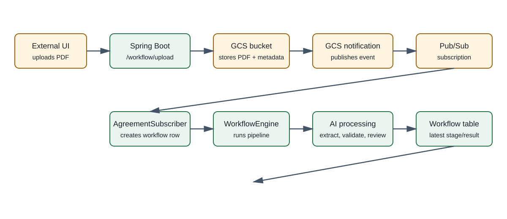

# Credit Agreement AI

Spring Boot proof of concept for turning credit agreement PDFs into structured deal data.

## Architecture



The flow is split into three phases:

1. **Upload and publish**
  - An external UI uploads a PDF to `POST /workflow/upload`.
  - The application creates a `workflow` row with status `UPLOADING`, records the `UPLOAD` event in `workflow_event`, then stores the PDF and `uuid`/`username` metadata in Google Cloud Storage.
  - The upload event transitions from `STARTED` to `SUCCESS` or `FAILED` and records duration/failure reason.
   - GCS detects the new object and an external notification publishes an object-created event to Pub/Sub.

2. **Subscribe and start**
   - This application subscribes to `agreement-upload-sub`.
   - `PubSubListener` forwards the message to `AgreementSubscriber`.
   - `AgreementSubscriber` reads the GCS event, updates the existing workflow row with the GCS metadata and status `EXTRACTING`, and starts the workflow.

3. **Process and poll**
   - The extraction agent reads the PDF from GCS and sends it directly to the LLM. The workflow then validates and reviews the extracted deal, repeating the review/validation pass up to two times when validation errors remain, and persists each stage.
  - The external UI is expected to poll the workflow table and read the latest status and deal data.

Current status progression:

```text
UPLOADING -> EXTRACTING -> VALIDATING -> REVIEWING -> HUMAN_REVIEW_PENDING -> COMPLETED
```

`FAILED` is reported when processing exhausts its retries.

All configured deal fields are required except `department`, `branch`, and `processingAreaCode`, which are supplied by the UI. When the global proposed commitment is missing, it is calculated from every facility's proposed commitment when the deal currency and all amount evidence are available. Remaining validation errors after three review loops are included in the result for human review.

## Upload API

```http
POST /workflow/upload
Content-Type: multipart/form-data
```

Parameters:

- `uuid`: workflow identifier
- `username`: user identifier
- `file`: PDF document

Example:

```bash
curl -X POST http://localhost:8080/workflow/upload \
  -F "uuid=workflow-123" \
  -F "username=ops-user" \
  -F "file=@/path/to/agreement.pdf"
```

The immediate response confirms the GCS upload. It does not contain the final deal result:

```text
File uploaded successfully: gs://<bucket>/<object-name>
```

## Workflow Polling API

The UI polls the database-backed workflow record after upload:

```http
GET /workflow/{uuid}/status
```

The response includes `uuid`, `status`, `username`, `updatedAt`, `completedAt`, and `failureReason`. It also includes `currentAgent` and `eventStatus` for the latest workflow event. If that event failed, `failedAgent` and `eventFailureReason` are included. This allows polling to report upload and processing activity from `workflow_event` before the Pub/Sub subscriber creates the `workflow` row. `UPLOAD/STARTED` reports `UPLOADING`; after upload succeeds, status advances to `EXTRACTING`. `404` is returned only when neither workflow nor event exists for the UUID.

When the workflow reaches `HUMAN_REVIEW_PENDING`, the UI loads the persisted extraction response:

```http
GET /workflow/{uuid}/metadata
```

The response is the stored extraction JSON, including `workflowId`, `deal`, validation issues, review issues, and overall confidence. The endpoint returns `404` for an unknown workflow and `409` while output is not ready.

After all returned fields are approved, the UI submits the review decisions:

```http
POST /workflow/{uuid}/sign-off
Content-Type: application/json
```

The request includes the review output and `reviewedFields`, whose entries must all have status `APPROVED`. The backend stores this payload in `human_output`, marks the `HUMAN_REVIEW` workflow event `SUCCESS`, and updates the workflow to `COMPLETED` with `completed_at` set. The endpoint returns `404` for an unknown workflow, `409` if the workflow is not awaiting review or its human-review event is missing, and `400` if the submitted review is incomplete or contains unapproved fields. Sign-off logs include the workflow UUID, decision outcome, and field count, but not the review payload.

For local development, the frontend defaults to `http://localhost:8080`. Set `VITE_API_BASE_URL` to override the backend origin.

## Configuration

Main configuration is in `src/main/resources/application.yaml`:

```yaml
google:
  bucket:
    name: loaniq-agreement
  pubsub:
    subscription: agreement-upload-sub
```

GCS notifications, the Pub/Sub topic, and the topic-to-subscription connection must be configured in Google Cloud outside this application. The application credentials must have access to GCS and Pub/Sub.

## Persistence

The workflow is stored in the `workflow` table. Each processing stage updates the workflow status and serialized metadata. The `workflow_event` table records upload and agent execution status, duration, and retry information.

The status endpoint combines the workflow row with the latest workflow event so the UI can report upload and processing progress. Review sign-off is persisted through the sign-off endpoint; deal creation is not implemented by this backend.

Workflow rows no longer store `next_agent`; progress is represented by `status`. Event IDs are stable stage numbers scoped to each workflow: `1` upload, `2` extraction, `3` validation, `4` review, and `5` human review. The event primary key is `(workflow_id, id)` so separate workflows can use the same stage IDs.

## Run Locally

```bash
./mvnw spring-boot:run
```

On Windows:

```powershell
.\mvnw.cmd spring-boot:run
```

The application runs on port `8080` by default.

## Technology

- Java 17
- Spring Boot 3.1.0
- Google Cloud Storage and Pub/Sub
- Google ADK / LLM extraction
- Spring Data JPA
- H2 database for local development
